# Public examples and actual segmentation results

All examples use WeVisOne-VL-4B. Images show timepoint 0; Z stacks use Max projection. Label files include all successfully computed timepoints. Rejected predictions are not empty background masks.

[Interactive HTML gallery](examples.html) · [Workflow](workflow.md) · [Sources and validation](research.md)

## human_mitosis

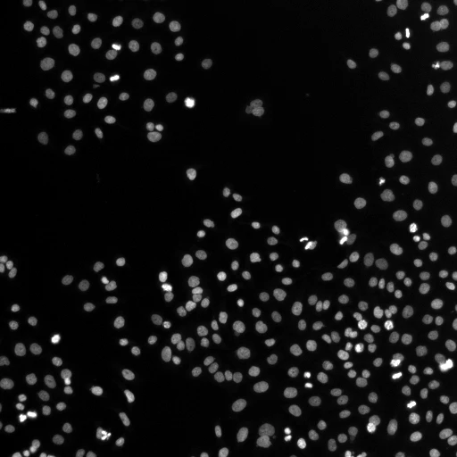

**Shape:** `(1, 1, 1, 512, 512)` (TCZYX) · **type:** Cells & organoids · **storage:** 0.14 MB

### `nuclei` — complete

Prompt: **each bright fluorescent cell nucleus** · channels `1`

Timepoint 0: 127 predicted objects. 1/1 timepoints completed. Mask coverage: 6.3%.

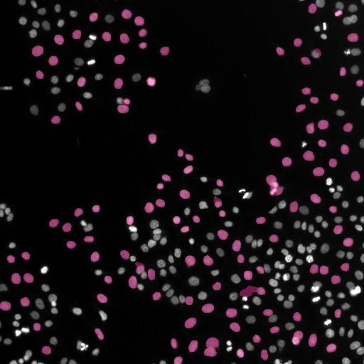

[Download uint32 labels and time indices](downloads/human_mitosis-nuclei-labels.npz)

**Sources:**

- https://scikit-image.org/docs/stable/api/skimage.data.html#skimage.data.human_mitosis

**Attribution/license:**  · CC0; David Root

## immunohistochemistry

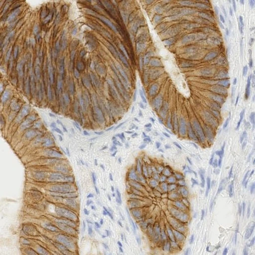

**Shape:** `(1, 3, 1, 512, 512)` (TCZYX) · **type:** Histology & tissue · **storage:** 0.88 MB

### `glands` — complete

Prompt: **colonic glands** · channels `1,2,3`

Timepoint 0: 4 predicted objects. 1/1 timepoints completed. Mask coverage: 59.7%.

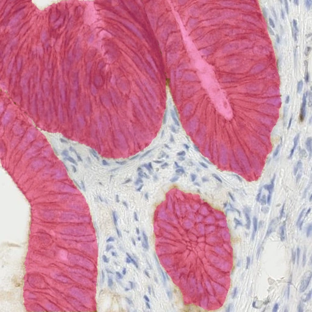

[Download uint32 labels and time indices](downloads/immunohistochemistry-glands-labels.npz)

**Sources:**

- https://scikit-image.org/docs/stable/api/skimage.data.html#skimage.data.immunohistochemistry

**Attribution/license:**  · No known copyright restrictions; CMMI

## cell

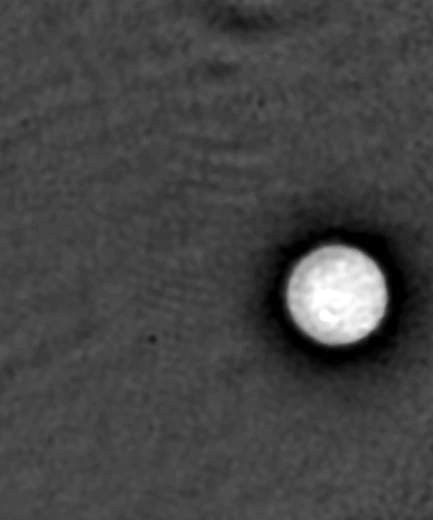

**Shape:** `(1, 1, 1, 660, 550)` (TCZYX) · **type:** Cells & organoids · **storage:** 0.17 MB

### `cell` — complete

Prompt: **cell** · channels `1`

Timepoint 0: 1 predicted objects. 1/1 timepoints completed. Mask coverage: 6.0%.

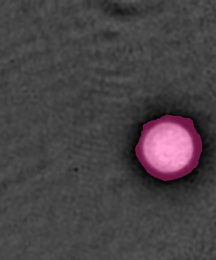

[Download uint32 labels and time indices](downloads/cell-cell-labels.npz)

**Sources:**

- https://scikit-image.org/docs/stable/api/skimage.data.html#skimage.data.cell

**Attribution/license:**  · CC0; Paul Mueller et al.

## organoids_im9

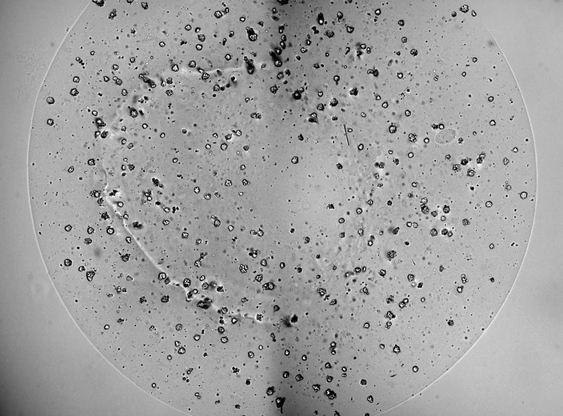

**Shape:** `(1, 1, 1, 1040, 1408)` (TCZYX) · **type:** Cells & organoids · **storage:** 1.06 MB

### `organoids` — failed

Prompt: **organoids** · channels `1`

Prediction rejected: Model generated 210 object tokens but 209 valid boxes. Refusing misaligned mask decoding; try a more specific prompt or an explicit smaller ROI.

**Sources:**

- https://zenodo.org/records/14036957

**Attribution/license:**  · CC BY 4.0

## organoids_im10

**Shape:** `(1, 1, 1, 1040, 1408)` (TCZYX) · **type:** Cells & organoids · **storage:** 0.97 MB

### `organoids` — complete

Prompt: **organoids** · channels `1`

Timepoint 0: 83 predicted objects. 1/1 timepoints completed. Mask coverage: 2.4%. Foreground Dice: 0.881 against consensus (not an instance score).

[Download uint32 labels and time indices](downloads/organoids_im10-organoids-labels.npz)

**Sources:**

- https://zenodo.org/records/14036957

**Attribution/license:**  · CC BY 4.0

## local-dendrite-spines

**Shape:** `(1, 1, 41, 157, 116)` (TCZYX) · **type:** Neurites & vessels · **storage:** 0.09 MB

### `dendrite` — complete

Prompt: **the main dendritic shaft** · channels `1`

Timepoint 0: 1 predicted objects. 1/1 timepoints completed. Mask coverage: 20.4%.

[Download uint32 labels and time indices](downloads/local-dendrite-spines-dendrite-labels.npz)

### `spines` — complete

Prompt: **small dendritic spines attached to the shaft** · channels `1`

Timepoint 0: 3 predicted objects. 1/1 timepoints completed. Mask coverage: 1.9%.

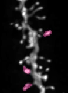

[Download uint32 labels and time indices](downloads/local-dendrite-spines-spines-labels.npz)

**Sources:**

- https://raw.githubusercontent.com/morphonets/misc/3ffb1bee97666634faf12c060650a6052a30fc26/dataset-demos/SpotSpine/SpotSpine_ImageStack_Test.tif
- https://imagej.net/plugins/spot-spine

**Attribution/license:**  · Public SNT/Spot Spine demo; no separate data license declared in the mirror.

## local-drosophila-olfactory-neuron

**Shape:** `(1, 1, 60, 512, 512)` (TCZYX) · **type:** Neurites & vessels · **storage:** 0.30 MB

### `neuron` — complete

Prompt: **the branching neuron and its neurites** · channels `1`

Timepoint 0: 1 predicted objects. 1/1 timepoints completed. Mask coverage: 2.5%.

[Download uint32 labels and time indices](downloads/local-drosophila-olfactory-neuron-neuron-labels.npz)

**Sources:**

- Local PublicData collection; original URL not established.

**Attribution/license:**  · Publicly downloadable sample; no separate file-specific redistribution license identified

## local-mouse-brain-astrocytes-vessels

**Shape:** `(1, 3, 36, 370, 370)` (TCZYX) · **type:** Neurites & vessels · **storage:** 5.82 MB

### `vessels` — complete

Prompt: **blood vessels** · channels `1,2,3`

Timepoint 0: 1 predicted objects. 1/1 timepoints completed. Mask coverage: 93.5%. High coverage: inspect foreground and background in the overlay.

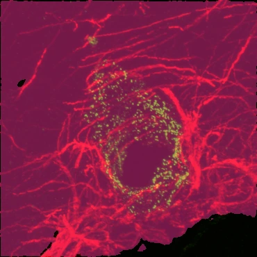

[Download uint32 labels and time indices](downloads/local-mouse-brain-astrocytes-vessels-vessels-labels.npz)

### `processes` — complete

Prompt: **red branching astrocyte processes** · channels `1,2,3`

Timepoint 0: 1 predicted objects. 1/1 timepoints completed. Mask coverage: 92.0%. High coverage: inspect foreground and background in the overlay.

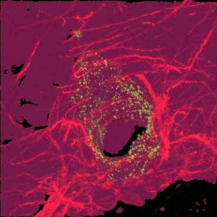

[Download uint32 labels and time indices](downloads/local-mouse-brain-astrocytes-vessels-processes-labels.npz)

**Sources:**

- https://imagej.net/ij/images/GFAP-FVII.zip
- https://imagej.net/ij/images/GFAP-FVII.txt

**Attribution/license:** Tony Collins / ImageJ for Microscopy · Public ImageJ sample; no separate data license declared.

## local-neural-organoid-section

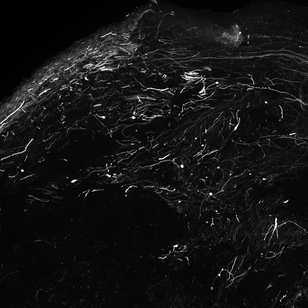

**Shape:** `(1, 1, 21, 2048, 2048)` (TCZYX) · **type:** Histology & tissue · **storage:** 127.95 MB

### `tissue` — complete

Prompt: **the complete visible tissue section** · channels `1`

Timepoint 0: 1 predicted objects. 1/1 timepoints completed. Mask coverage: 46.7%.

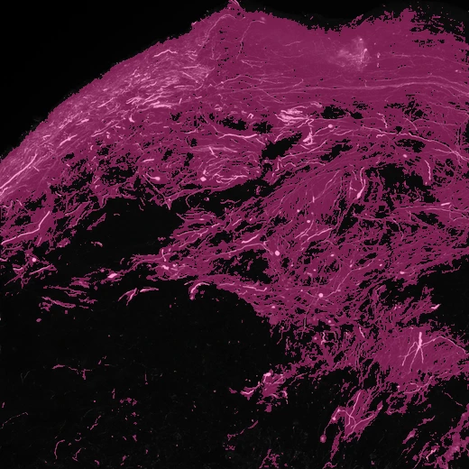

[Download uint32 labels and time indices](downloads/local-neural-organoid-section-tissue-labels.npz)

### `fibers` — complete

Prompt: **branching neurofilament fibers** · channels `1`

Timepoint 0: 1 predicted objects. 1/1 timepoints completed. Mask coverage: 0.3%.

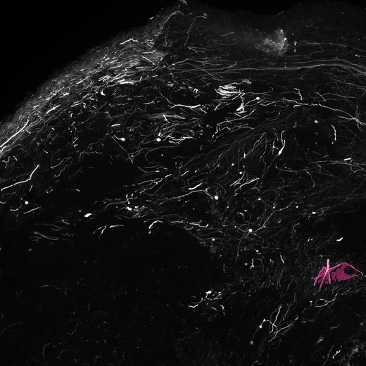

[Download uint32 labels and time indices](downloads/local-neural-organoid-section-fibers-labels.npz)

**Sources:**

- https://zenodo.org/records/13899833

**Attribution/license:** Yuanzheng Ma, Tsinghua University / Tsinghua-Berkeley Shenzhen Institute · CC-BY-4.0

## local-REAL-LYSOSOME

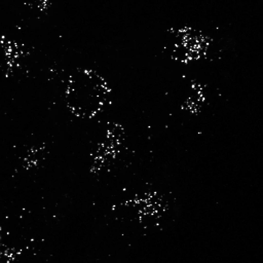

**Shape:** `(19, 1, 1, 512, 512)` (TCZYX) · **type:** Cells & organoids · **storage:** 1.82 MB

### `lysosomes` — complete

Prompt: **bright fluorescent lysosomes** · channels `1`

Timepoint 0: 9 predicted objects. 19/19 timepoints completed. Mask coverage: 9.3%.

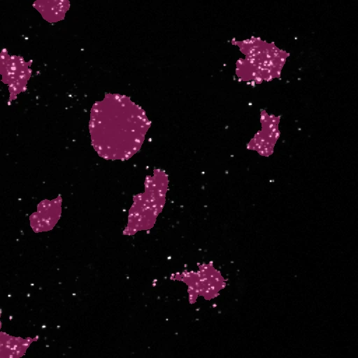

[Download uint32 labels and time indices](downloads/local-REAL-LYSOSOME-lysosomes-labels.npz)

**Sources:**

- https://zenodo.org/records/14043236

**Attribution/license:**  · Publicly downloadable sample; no separate file-specific redistribution license identified

## local-neurite-outgrowth-3t

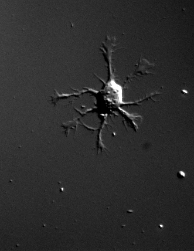

**Shape:** `(3, 1, 1, 428, 331)` (TCZYX) · **type:** Neurites & vessels · **storage:** 0.58 MB

### `neurites` — complete

Prompt: **the thin branching neuronal processes** · channels `1`

Timepoint 0: 4 predicted objects. 3/3 timepoints completed. Mask coverage: 2.2%.

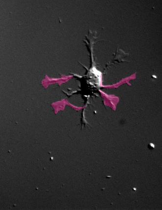

[Download uint32 labels and time indices](downloads/local-neurite-outgrowth-3t-neurites-labels.npz)

### `soma` — complete

Prompt: **the neuronal cell body** · channels `1`

Timepoint 0: 1 predicted objects. 3/3 timepoints completed. Mask coverage: 4.5%.

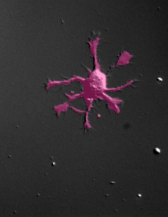

[Download uint32 labels and time indices](downloads/local-neurite-outgrowth-3t-soma-labels.npz)

**Sources:**

- Local PublicData collection; original URL not established.

**Attribution/license:**  · CIL701 Creative Commons Attribution

## local-neurites-2d

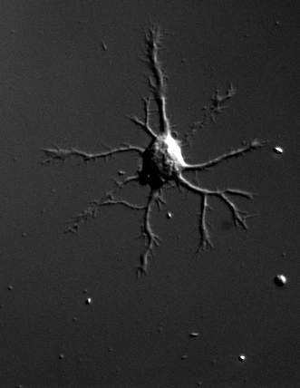

**Shape:** `(1, 1, 1, 428, 331)` (TCZYX) · **type:** Neurites & vessels · **storage:** 0.20 MB

### `neurites` — complete

Prompt: **the thin branching neuronal processes** · channels `1`

Timepoint 0: 4 predicted objects. 1/1 timepoints completed. Mask coverage: 2.9%.

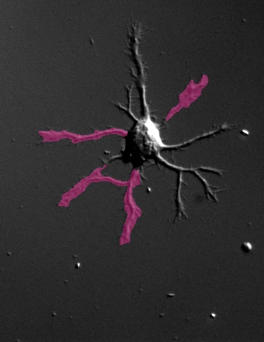

[Download uint32 labels and time indices](downloads/local-neurites-2d-neurites-labels.npz)

### `soma` — complete

Prompt: **the neuronal cell body** · channels `1`

Timepoint 0: 1 predicted objects. 1/1 timepoints completed. Mask coverage: 5.5%.

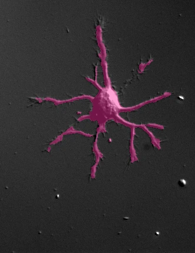

[Download uint32 labels and time indices](downloads/local-neurites-2d-soma-labels.npz)

**Sources:**

- Local PublicData collection; original URL not established.

**Attribution/license:**  · CIL701 Creative Commons Attribution

## public-skin

**Shape:** `(1, 3, 1, 960, 1280)` (TCZYX) · **type:** Histology & tissue · **storage:** 3.94 MB

### `epidermis` — complete

Prompt: **the continuous epidermal layer** · channels `1,2,3`

Timepoint 0: 1 predicted objects. 1/1 timepoints completed. Mask coverage: 20.8%.

[Download uint32 labels and time indices](downloads/public-skin-epidermis-labels.npz)

### `dermis` — complete

Prompt: **the underlying dermis** · channels `1,2,3`

Timepoint 0: 1 predicted objects. 1/1 timepoints completed. Mask coverage: 73.2%.

[Download uint32 labels and time indices](downloads/public-skin-dermis-labels.npz)

### `tissue` — complete

Prompt: **all tissue in the section** · channels `1,2,3`

Timepoint 0: 1 predicted objects. 1/1 timepoints completed. Mask coverage: 81.5%. High coverage: inspect foreground and background in the overlay.

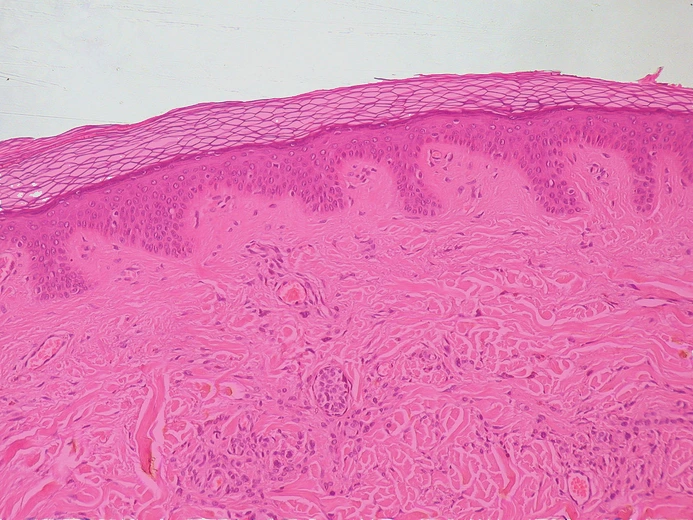

[Download uint32 labels and time indices](downloads/public-skin-tissue-labels.npz)

**Sources:**

- https://scikit-image.org/docs/stable/api/skimage.data.html#skimage.data.skin

**Attribution/license:**  · See scikit-image dataset-specific attribution

## public-retina

**Shape:** `(1, 3, 1, 1411, 1411)` (TCZYX) · **type:** Neurites & vessels · **storage:** 3.23 MB

### `vessels` — complete

Prompt: **the branching retinal blood vessels** · channels `1,2,3`

Timepoint 0: 1 predicted objects. 1/1 timepoints completed. Mask coverage: 76.1%.

[Download uint32 labels and time indices](downloads/public-retina-vessels-labels.npz)

### `optic_disc` — complete

Prompt: **the bright optic disc** · channels `1,2,3`

Timepoint 0: 1 predicted objects. 1/1 timepoints completed. Mask coverage: 1.3%.

[Download uint32 labels and time indices](downloads/public-retina-optic_disc-labels.npz)

### `retina` — complete

Prompt: **the complete retinal field** · channels `1,2,3`

Timepoint 0: 1 predicted objects. 1/1 timepoints completed. Mask coverage: 76.1%.

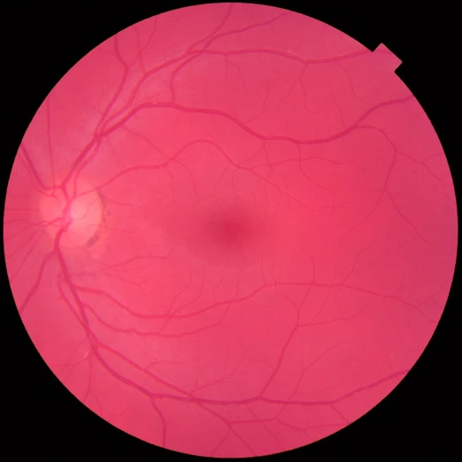

[Download uint32 labels and time indices](downloads/public-retina-retina-labels.npz)

**Sources:**

- https://scikit-image.org/docs/stable/api/skimage.data.html#skimage.data.retina

**Attribution/license:**  · See scikit-image dataset-specific attribution

## public-lily-stem

**Shape:** `(1, 4, 1, 922, 922)` (TCZYX) · **type:** Other structures · **storage:** 5.68 MB

### `bundles` — complete

Prompt: **the vascular bundles in the plant stem** · channels `1,2,3`

Timepoint 0: 0 predicted objects. 1/1 timepoints completed. Mask coverage: 0.0%. The model returned an empty mask; this is not evidence that the structure is absent.

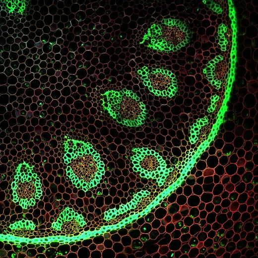

[Download uint32 labels and time indices](downloads/public-lily-stem-bundles-labels.npz)

### `stem` — complete

Prompt: **the complete plant stem cross-section** · channels `1,2,3`

Timepoint 0: 1 predicted objects. 1/1 timepoints completed. Mask coverage: 15.8%.

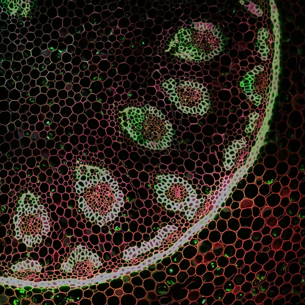

[Download uint32 labels and time indices](downloads/public-lily-stem-stem-labels.npz)

**Sources:**

- https://scikit-image.org/docs/stable/api/skimage.data.html#skimage.data.lily

**Attribution/license:**  · CC0; Genevieve Buckley, Monash Micro Imaging

## public-diatoms

**Shape:** `(1, 3, 1, 486, 512)` (TCZYX) · **type:** Other structures · **storage:** 0.79 MB

### `diatoms` — complete

Prompt: **the individual diatoms** · channels `1,2,3`

Timepoint 0: 5 predicted objects. 1/1 timepoints completed. Mask coverage: 31.9%.

[Download uint32 labels and time indices](downloads/public-diatoms-diatoms-labels.npz)

### `round` — complete

Prompt: **round diatoms** · channels `1,2,3`

Timepoint 0: 2 predicted objects. 1/1 timepoints completed. Mask coverage: 14.8%.

[Download uint32 labels and time indices](downloads/public-diatoms-round-labels.npz)

### `elongated` — complete

Prompt: **elongated diatoms** · channels `1,2,3`

Timepoint 0: 3 predicted objects. 1/1 timepoints completed. Mask coverage: 16.9%.

[Download uint32 labels and time indices](downloads/public-diatoms-elongated-labels.npz)

**Sources:**

- https://imagej.net/ij/images/Diatoms.jpg

**Attribution/license:**  · Publicly downloadable sample; no separate file-specific redistribution license identified

## public-embryos

**Shape:** `(1, 3, 1, 1200, 1600)` (TCZYX) · **type:** Other structures · **storage:** 3.49 MB

### `embryos` — complete

Prompt: **the complete embryos** · channels `1,2,3`

Timepoint 0: 22 predicted objects. 1/1 timepoints completed. Mask coverage: 3.7%.

[Download uint32 labels and time indices](downloads/public-embryos-embryos-labels.npz)

### `yolk` — complete

Prompt: **the round yolk sacs** · channels `1,2,3`

Timepoint 0: 5 predicted objects. 1/1 timepoints completed. Mask coverage: 0.8%.

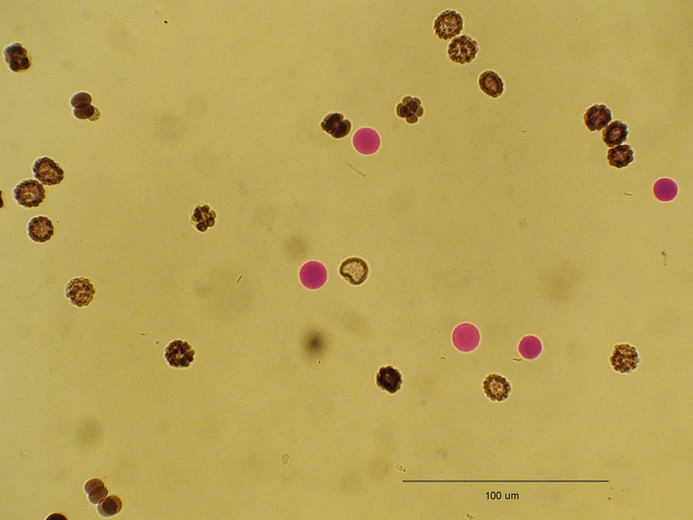

[Download uint32 labels and time indices](downloads/public-embryos-yolk-labels.npz)

**Sources:**

- https://imagej.net/ij/images/embryos.jpg

**Attribution/license:**  · Publicly downloadable sample; no separate file-specific redistribution license identified

## public-adipose

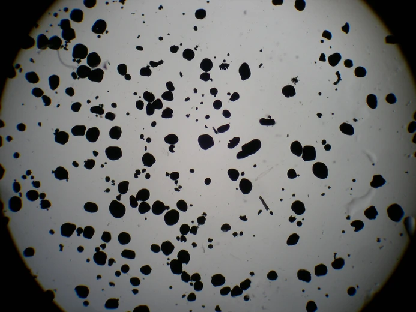

**Shape:** `(1, 3, 1, 1200, 1600)` (TCZYX) · **type:** Histology & tissue · **storage:** 4.04 MB

### `adipocytes` — complete

Prompt: **the large round adipocytes** · channels `1,2,3`

Timepoint 0: 1 predicted objects. 1/1 timepoints completed. Mask coverage: 92.6%. High coverage: inspect foreground and background in the overlay.

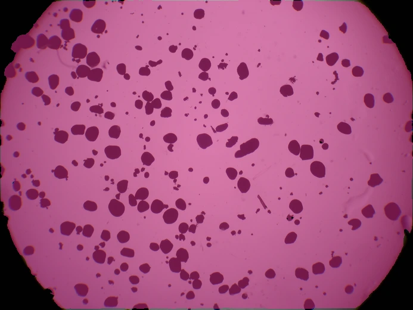

[Download uint32 labels and time indices](downloads/public-adipose-adipocytes-labels.npz)

### `fat` — complete

Prompt: **the entire adipose tissue region** · channels `1,2,3`

Timepoint 0: 1 predicted objects. 1/1 timepoints completed. Mask coverage: 51.9%.

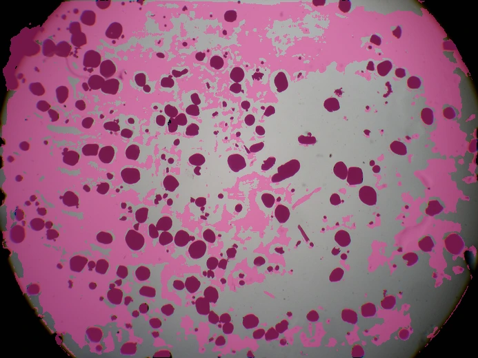

[Download uint32 labels and time indices](downloads/public-adipose-fat-labels.npz)

### `septa` — complete

Prompt: **connective tissue between the fat cells** · channels `1,2,3`

Timepoint 0: 1 predicted objects. 1/1 timepoints completed. Mask coverage: 58.0%.

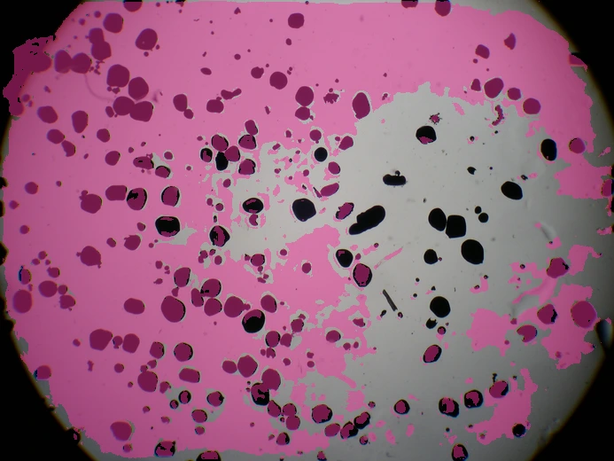

[Download uint32 labels and time indices](downloads/public-adipose-septa-labels.npz)

**Sources:**

- https://imagej.net/ij/images/fat-cells.zip

**Attribution/license:** Lakishea Hawkins, Department of Clinical Nutrition, University of Maryland Baltimore · Publicly downloadable sample; no separate file-specific redistribution license identified

## public-em-cos7-3d

**Shape:** `(1, 1, 32, 512, 512)` (TCZYX) · **type:** EM · **storage:** 7.67 MB

### `mitochondria` — complete

Prompt: **mitochondria with visible internal cristae** · channels `1`

Timepoint 0: 0 predicted objects. 1/1 timepoints completed. Mask coverage: 0.0%. The model returned an empty mask; this is not evidence that the structure is absent.

[Download uint32 labels and time indices](downloads/public-em-cos7-3d-mitochondria-labels.npz)

### `er` — complete

Prompt: **endoplasmic reticulum membranes** · channels `1`

Timepoint 0: 0 predicted objects. 1/1 timepoints completed. Mask coverage: 0.0%. The model returned an empty mask; this is not evidence that the structure is absent.

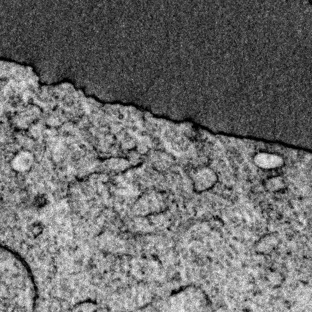

[Download uint32 labels and time indices](downloads/public-em-cos7-3d-er-labels.npz)

### `golgi` — complete

Prompt: **the Golgi apparatus** · channels `1`

Timepoint 0: 1 predicted objects. 1/1 timepoints completed. Mask coverage: 63.5%.

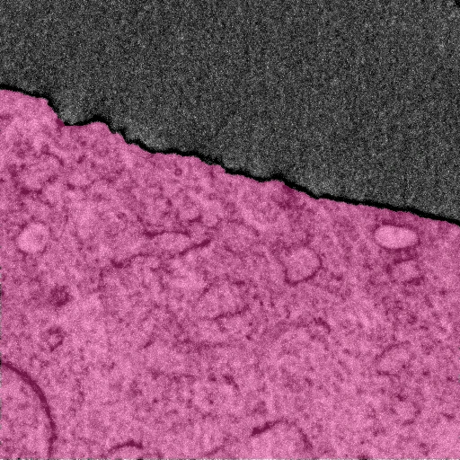

[Download uint32 labels and time indices](downloads/public-em-cos7-3d-golgi-labels.npz)

### `lipid_droplets` — complete

Prompt: **lipid droplets** · channels `1`

Timepoint 0: 4 predicted objects. 1/1 timepoints completed. Mask coverage: 1.7%.

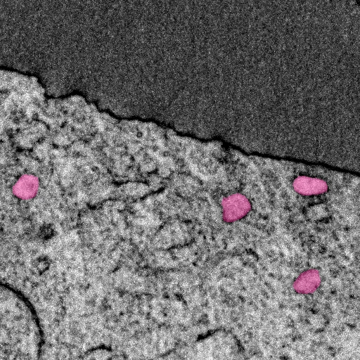

[Download uint32 labels and time indices](downloads/public-em-cos7-3d-lipid_droplets-labels.npz)

**Sources:**

- https://cellmapchallenge.janelia.org/
- https://janelia-cosem-datasets.s3.amazonaws.com/jrc_cos7-1a/jrc_cos7-1a.zarr/recon-1/em/fibsem-uint8

**Attribution/license:**  · CC BY 4.0; CellMap Segmentation Challenge collection

Projection merges EM sections; use accompanying 2D slice for individual organelles

## public-em-cos7-2d

**Shape:** `(1, 1, 1, 512, 512)` (TCZYX) · **type:** EM · **storage:** 0.25 MB

### `mitochondria` — complete

Prompt: **mitochondria with visible internal cristae** · channels `1`

Timepoint 0: 0 predicted objects. 1/1 timepoints completed. Mask coverage: 0.0%. The model returned an empty mask; this is not evidence that the structure is absent.

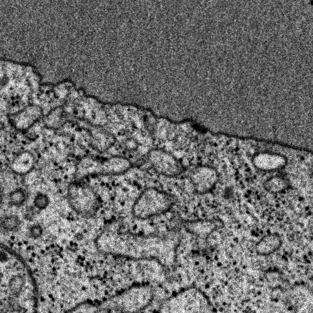

[Download uint32 labels and time indices](downloads/public-em-cos7-2d-mitochondria-labels.npz)

### `er` — complete

Prompt: **endoplasmic reticulum membranes** · channels `1`

Timepoint 0: 1 predicted objects. 1/1 timepoints completed. Mask coverage: 63.7%.

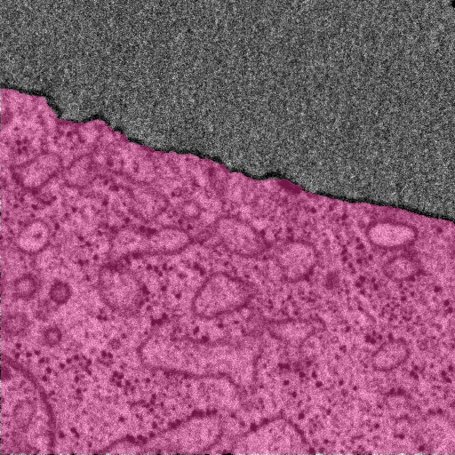

[Download uint32 labels and time indices](downloads/public-em-cos7-2d-er-labels.npz)

### `golgi` — complete

Prompt: **the Golgi apparatus** · channels `1`

Timepoint 0: 1 predicted objects. 1/1 timepoints completed. Mask coverage: 63.9%.

[Download uint32 labels and time indices](downloads/public-em-cos7-2d-golgi-labels.npz)

### `lipid_droplets` — complete

Prompt: **lipid droplets** · channels `1`

Timepoint 0: 19 predicted objects. 1/1 timepoints completed. Mask coverage: 11.7%.

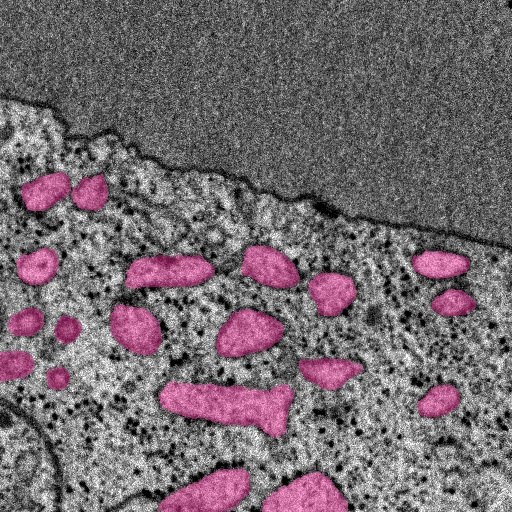

[Download uint32 labels and time indices](downloads/public-em-cos7-2d-lipid_droplets-labels.npz)

**Sources:**

- https://cellmapchallenge.janelia.org/
- https://janelia-cosem-datasets.s3.amazonaws.com/jrc_cos7-1a/jrc_cos7-1a.zarr/recon-1/em/fibsem-uint8

**Attribution/license:**  · CC BY 4.0; CellMap Segmentation Challenge collection

## public-em-liver-3d

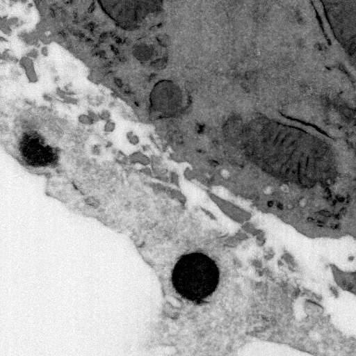

**Shape:** `(1, 1, 32, 512, 512)` (TCZYX) · **type:** EM · **storage:** 7.78 MB

### `mitochondria` — complete

Prompt: **mitochondria with visible internal cristae** · channels `1`

Timepoint 0: 1 predicted objects. 1/1 timepoints completed. Mask coverage: 4.1%.

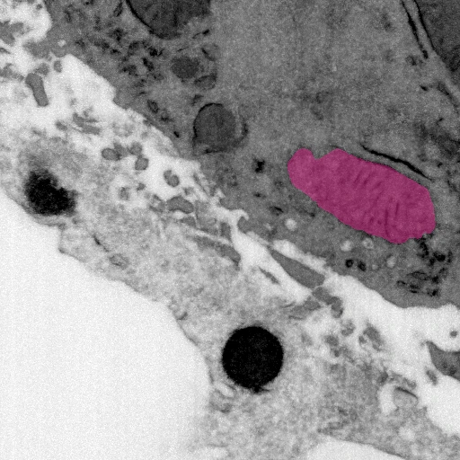

[Download uint32 labels and time indices](downloads/public-em-liver-3d-mitochondria-labels.npz)

### `er` — complete

Prompt: **endoplasmic reticulum membranes** · channels `1`

Timepoint 0: 0 predicted objects. 1/1 timepoints completed. Mask coverage: 0.0%. The model returned an empty mask; this is not evidence that the structure is absent.

[Download uint32 labels and time indices](downloads/public-em-liver-3d-er-labels.npz)

### `golgi` — complete

Prompt: **the Golgi apparatus** · channels `1`

Timepoint 0: 1 predicted objects. 1/1 timepoints completed. Mask coverage: 81.9%. High coverage: inspect foreground and background in the overlay.

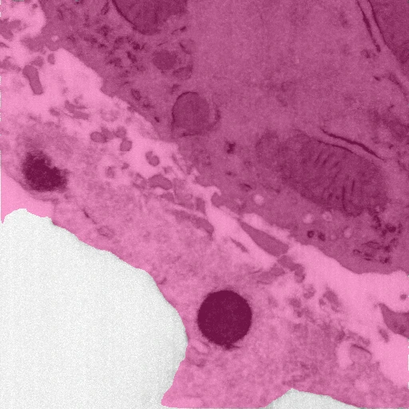

[Download uint32 labels and time indices](downloads/public-em-liver-3d-golgi-labels.npz)

### `lipid_droplets` — complete

Prompt: **lipid droplets** · channels `1`

Timepoint 0: 1 predicted objects. 1/1 timepoints completed. Mask coverage: 1.4%.

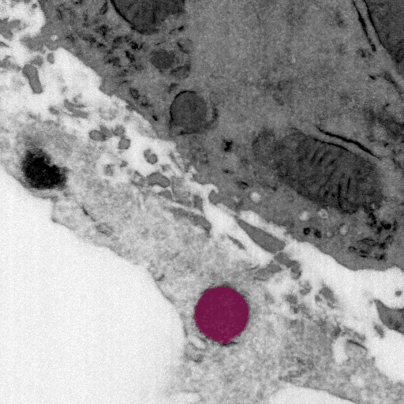

[Download uint32 labels and time indices](downloads/public-em-liver-3d-lipid_droplets-labels.npz)

**Sources:**

- https://cellmapchallenge.janelia.org/
- https://janelia-cosem-datasets.s3.amazonaws.com/jrc_mus-liver/jrc_mus-liver.zarr/recon-1/em/fibsem-uint8

**Attribution/license:**  · CC BY 4.0; CellMap Segmentation Challenge collection

Projection merges EM sections; use accompanying 2D slice for individual organelles

## public-em-liver-2d

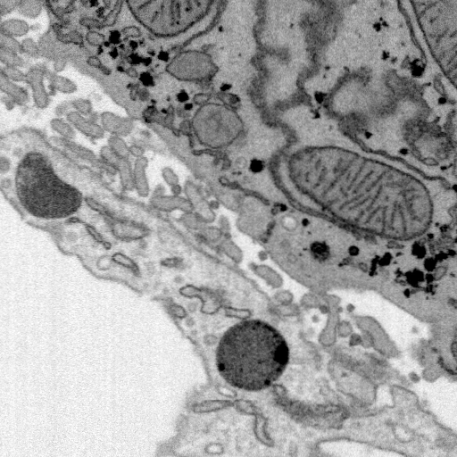

**Shape:** `(1, 1, 1, 512, 512)` (TCZYX) · **type:** EM · **storage:** 0.25 MB

### `mitochondria` — complete

Prompt: **mitochondria with visible internal cristae** · channels `1`

Timepoint 0: 1 predicted objects. 1/1 timepoints completed. Mask coverage: 4.2%.

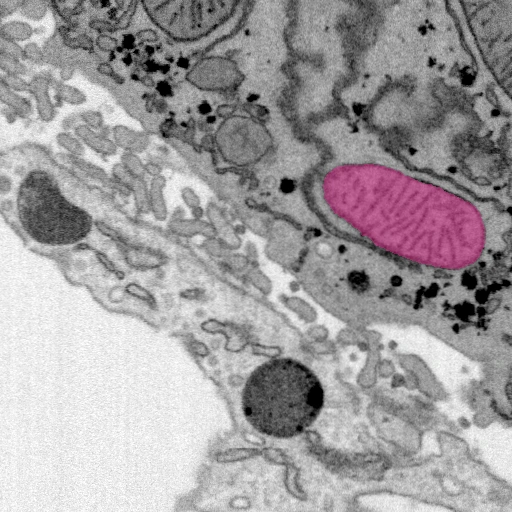

[Download uint32 labels and time indices](downloads/public-em-liver-2d-mitochondria-labels.npz)

### `er` — complete

Prompt: **endoplasmic reticulum membranes** · channels `1`

Timepoint 0: 1 predicted objects. 1/1 timepoints completed. Mask coverage: 4.4%.

[Download uint32 labels and time indices](downloads/public-em-liver-2d-er-labels.npz)

### `golgi` — complete

Prompt: **the Golgi apparatus** · channels `1`

Timepoint 0: 1 predicted objects. 1/1 timepoints completed. Mask coverage: 83.9%. High coverage: inspect foreground and background in the overlay.

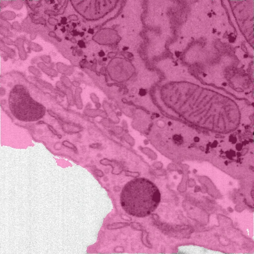

[Download uint32 labels and time indices](downloads/public-em-liver-2d-golgi-labels.npz)

### `lipid_droplets` — complete

Prompt: **lipid droplets** · channels `1`

Timepoint 0: 6 predicted objects. 1/1 timepoints completed. Mask coverage: 10.2%.

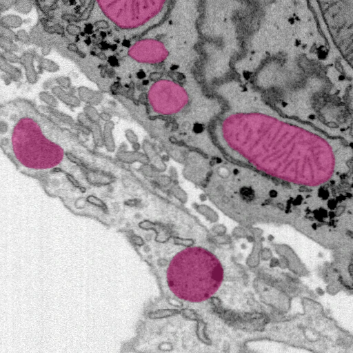

[Download uint32 labels and time indices](downloads/public-em-liver-2d-lipid_droplets-labels.npz)

**Sources:**

- https://cellmapchallenge.janelia.org/
- https://janelia-cosem-datasets.s3.amazonaws.com/jrc_mus-liver/jrc_mus-liver.zarr/recon-1/em/fibsem-uint8

**Attribution/license:**  · CC BY 4.0; CellMap Segmentation Challenge collection

## public-em-mitochondria-mib

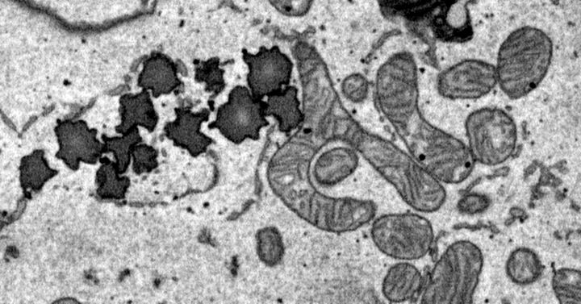

**Shape:** `(1, 1, 1, 396, 756)` (TCZYX) · **type:** EM · **storage:** 0.32 MB

### `mitochondria` — complete

Prompt: **mitochondria with visible cristae** · channels `1`

Timepoint 0: 0 predicted objects. 1/1 timepoints completed. Mask coverage: 0.0%. The model returned an empty mask; this is not evidence that the structure is absent.

[Download uint32 labels and time indices](downloads/public-em-mitochondria-mib-mitochondria-labels.npz)

### `membranes` — complete

Prompt: **the membrane-enclosed organelles** · channels `1`

Timepoint 0: 16 predicted objects. 1/1 timepoints completed. Mask coverage: 21.0%.

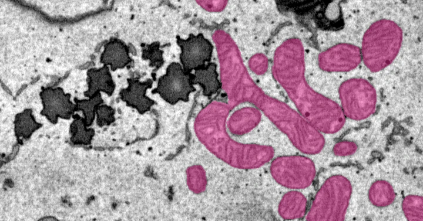

[Download uint32 labels and time indices](downloads/public-em-mitochondria-mib-membranes-labels.npz)

**Sources:**

- https://mib.helsinki.fi/help/main2/user-interface/menu/tools/tools-watershed.html

**Attribution/license:**  · Publicly downloadable sample; no separate file-specific redistribution license identified

## local-CMU1-whole-section

**Shape:** `(1, 3, 1, 2057, 2875)` (TCZYX) · **type:** Histology & tissue · **storage:** 5.36 MB

### `tissue` — complete

Prompt: **the entire tissue section, excluding the white background** · channels `1,2,3`

Timepoint 0: 1 predicted objects. 1/1 timepoints completed. Mask coverage: 18.8%.

[Download uint32 labels and time indices](downloads/local-CMU1-whole-section-tissue-labels.npz)

### `fat` — complete

Prompt: **adipose tissue** · channels `1,2,3`

Timepoint 0: 0 predicted objects. 1/1 timepoints completed. Mask coverage: 0.0%. The model returned an empty mask; this is not evidence that the structure is absent.

[Download uint32 labels and time indices](downloads/local-CMU1-whole-section-fat-labels.npz)

### `stroma` — complete

Prompt: **pink connective tissue** · channels `1,2,3`

Timepoint 0: 4 predicted objects. 1/1 timepoints completed. Mask coverage: 18.8%.

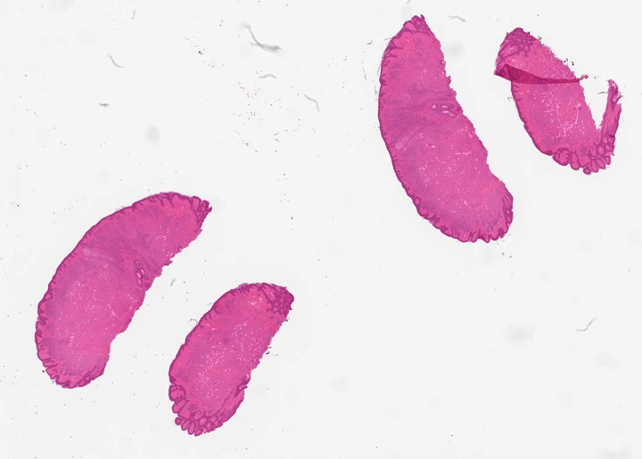

[Download uint32 labels and time indices](downloads/local-CMU1-whole-section-stroma-labels.npz)

### `vessels` — complete

Prompt: **blood vessels and their lumens** · channels `1,2,3`

Timepoint 0: 0 predicted objects. 1/1 timepoints completed. Mask coverage: 0.0%. The model returned an empty mask; this is not evidence that the structure is absent.

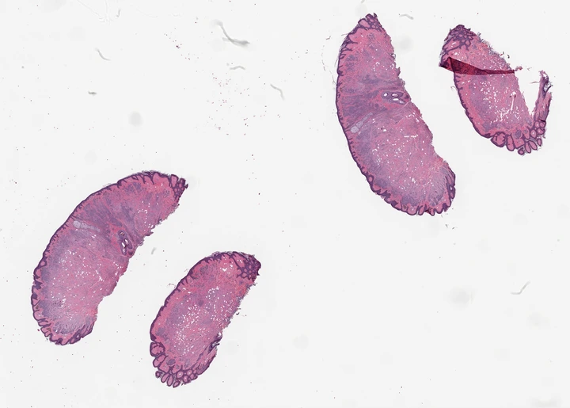

[Download uint32 labels and time indices](downloads/local-CMU1-whole-section-vessels-labels.npz)

**Sources:**

- https://openslide.cs.cmu.edu/download/openslide-testdata/Aperio/

**Attribution/license:**  · CC0; OpenSlide test data

## public-prostate-section

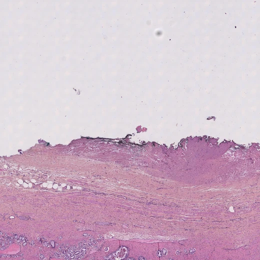

**Shape:** `(1, 3, 1, 2500, 2500)` (TCZYX) · **type:** Histology & tissue · **storage:** 11.74 MB

### `tissue` — complete

Prompt: **the entire tissue section, excluding the white background** · channels `1,2,3`

Timepoint 0: 1 predicted objects. 1/1 timepoints completed. Mask coverage: 45.1%.

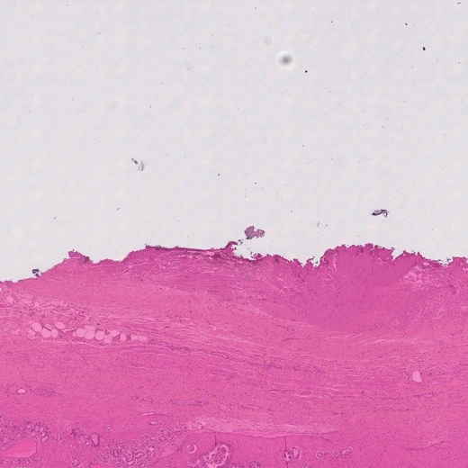

[Download uint32 labels and time indices](downloads/public-prostate-section-tissue-labels.npz)

### `glands` — complete

Prompt: **prostatic glands and their lumens** · channels `1,2,3`

Timepoint 0: 6 predicted objects. 1/1 timepoints completed. Mask coverage: 1.3%.

[Download uint32 labels and time indices](downloads/public-prostate-section-glands-labels.npz)

### `stroma` — complete

Prompt: **connective tissue stroma** · channels `1,2,3`

Timepoint 0: 1 predicted objects. 1/1 timepoints completed. Mask coverage: 45.2%.

[Download uint32 labels and time indices](downloads/public-prostate-section-stroma-labels.npz)

**Sources:**

- https://zenodo.org/records/18302140

**Attribution/license:**  · CC BY 4.0; Thierry Pecot QuPath workshop

## public-ki67-lymphoma-section

**Shape:** `(1, 3, 1, 2176, 1800)` (TCZYX) · **type:** Histology & tissue · **storage:** 7.46 MB

### `tissue` — complete

Prompt: **the entire tissue section, excluding the white background** · channels `1,2,3`

Timepoint 0: 1 predicted objects. 1/1 timepoints completed. Mask coverage: 49.7%.

[Download uint32 labels and time indices](downloads/public-ki67-lymphoma-section-tissue-labels.npz)

### `dab_positive` — complete

Prompt: **brown DAB-positive tissue** · channels `1,2,3`

Timepoint 0: 0 predicted objects. 1/1 timepoints completed. Mask coverage: 0.0%. The model returned an empty mask; this is not evidence that the structure is absent.

[Download uint32 labels and time indices](downloads/public-ki67-lymphoma-section-dab_positive-labels.npz)

### `stroma` — complete

Prompt: **connective tissue stroma** · channels `1,2,3`

Timepoint 0: 1 predicted objects. 1/1 timepoints completed. Mask coverage: 50.4%.

[Download uint32 labels and time indices](downloads/public-ki67-lymphoma-section-stroma-labels.npz)

**Sources:**

- https://zenodo.org/records/18302140

**Attribution/license:**  · CC BY 4.0; Thierry Pecot QuPath workshop

## public-ki67-lymphoma-dab-roi

**Shape:** `(1, 3, 1, 1024, 1024)` (TCZYX) · **type:** Histology & tissue · **storage:** 3.80 MB

### `tissue` — complete

Prompt: **the entire tissue section, excluding the white background** · channels `1,2,3`

Timepoint 0: 1 predicted objects. 1/1 timepoints completed. Mask coverage: 99.0%. High coverage: inspect foreground and background in the overlay.

[Download uint32 labels and time indices](downloads/public-ki67-lymphoma-dab-roi-tissue-labels.npz)

### `dab_positive` — complete

Prompt: **brown DAB-positive tissue** · channels `1,2,3`

Timepoint 0: 1 predicted objects. 1/1 timepoints completed. Mask coverage: 98.8%. High coverage: inspect foreground and background in the overlay.

[Download uint32 labels and time indices](downloads/public-ki67-lymphoma-dab-roi-dab_positive-labels.npz)

### `stroma` — complete

Prompt: **connective tissue stroma** · channels `1,2,3`

Timepoint 0: 1 predicted objects. 1/1 timepoints completed. Mask coverage: 99.0%. High coverage: inspect foreground and background in the overlay.

[Download uint32 labels and time indices](downloads/public-ki67-lymphoma-dab-roi-stroma-labels.npz)

**Sources:**

- https://zenodo.org/records/18302140

**Attribution/license:**  · CC BY 4.0; Thierry Pecot QuPath workshop
