# Curated public examples and actual segmentation results

All examples use WeVisOne-VL-4B. Images show timepoint 0; Z stacks use Max projection. Label files include all successfully computed timepoints. Rejected predictions are not empty background masks.

[Interactive HTML gallery](examples.html) · [Workflow](workflow.md) · [Sources and validation](research.md)

This is a positively selected demonstration gallery after prompt comparisons and visual inspection, not a representative accuracy benchmark. Unselected experiments remain in the research records. EM examples are native 2D sections, without Z projections.

## organoids_im10

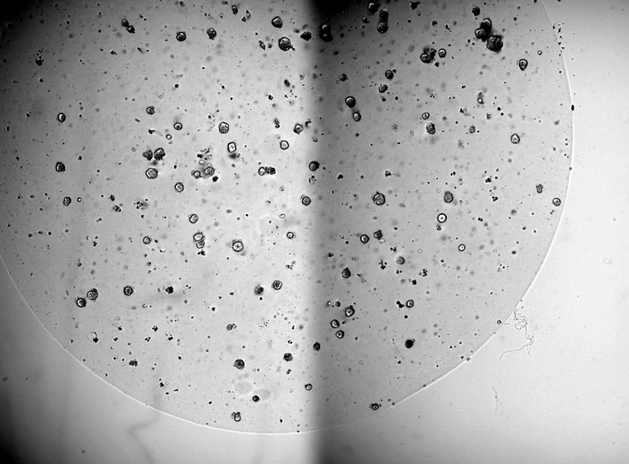

**Shape:** `(1, 1, 1, 1040, 1408)` (TCZYX) · **type:** Cells & organoids · **storage:** 0.97 MB

### `organoids` — complete

Prompt: **organoids** · channels `1`

Timepoint 0: 83 predicted objects. 1/1 timepoints completed. Mask coverage: 2.4%. Foreground Dice: 0.881 against consensus (not an instance score).

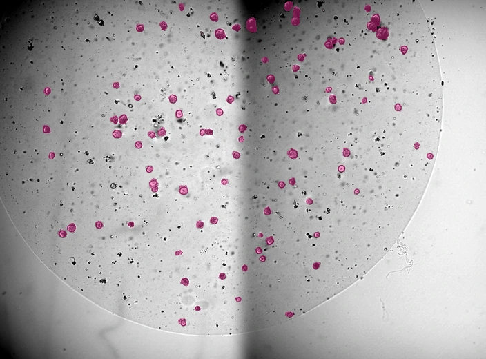

[Download uint32 labels and time indices](downloads/organoids_im10-organoids-labels.npz)

**Selection review:** Foreground agreement with the independent microSAM consensus mask; Dice 0.881.

**Sources:**

- https://zenodo.org/records/14036957

**Attribution/license:**  · CC BY 4.0

[Independent dataset reference, cyan](gallery/organoids_im10-reference.webp) · [Reference label file](downloads/organoids_im10-reference.npz)

## local-dendrite-spines

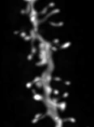

**Shape:** `(1, 1, 41, 157, 116)` (TCZYX) · **type:** Neurites & vessels · **storage:** 0.09 MB

### `dendrite` — complete

Prompt: **the main dendritic shaft** · channels `1`

Timepoint 0: 1 predicted objects. 1/1 timepoints completed. Mask coverage: 20.4%.

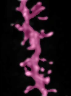

[Download uint32 labels and time indices](downloads/local-dendrite-spines-dendrite-labels.npz)

**Selection review:** Main shaft only. Spine-head candidates had low recall and are not shown.

**Sources:**

- https://raw.githubusercontent.com/morphonets/misc/3ffb1bee97666634faf12c060650a6052a30fc26/dataset-demos/SpotSpine/SpotSpine_ImageStack_Test.tif
- https://imagej.net/plugins/spot-spine

**Attribution/license:**  · Public SNT/Spot Spine demo; no separate data license declared in the mirror.

## local-drosophila-olfactory-neuron

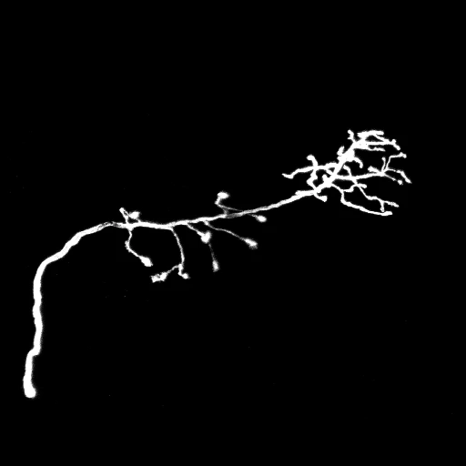

**Shape:** `(1, 1, 60, 512, 512)` (TCZYX) · **type:** Neurites & vessels · **storage:** 0.30 MB

### `neuron` — complete

Prompt: **the branching neuron and its neurites** · channels `1`

Timepoint 0: 1 predicted objects. 1/1 timepoints completed. Mask coverage: 2.5%.

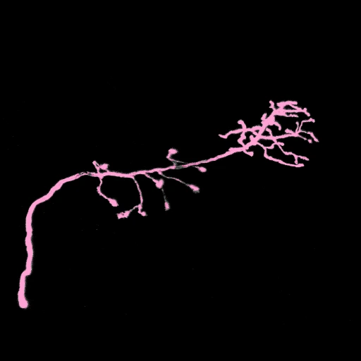

[Download uint32 labels and time indices](downloads/local-drosophila-olfactory-neuron-neuron-labels.npz)

**Selection review:** Visually reviewed arbor foreground; no manual segmentation reference.

**Sources:**

- Local PublicData collection; original URL not established.

**Attribution/license:**  · Publicly downloadable sample; no separate file-specific redistribution license identified

## public-skin

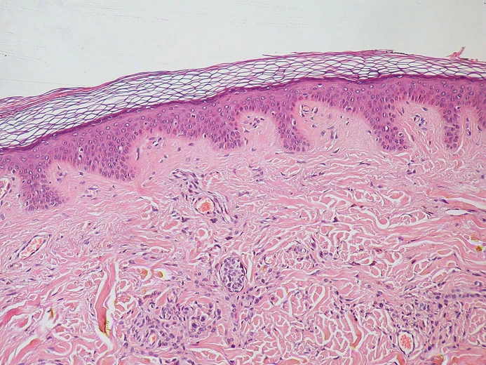

**Shape:** `(1, 3, 1, 960, 1280)` (TCZYX) · **type:** Histology & tissue · **storage:** 3.94 MB

### `epidermis` — complete

Prompt: **the continuous epidermal layer** · channels `1,2,3`

Timepoint 0: 1 predicted objects. 1/1 timepoints completed. Mask coverage: 20.8%.

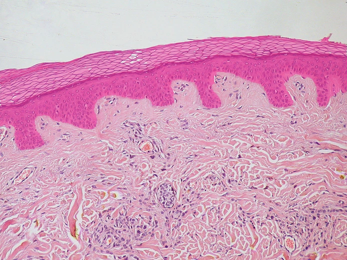

[Download uint32 labels and time indices](downloads/public-skin-epidermis-labels.npz)

### `dermis` — complete

Prompt: **the underlying dermis** · channels `1,2,3`

Timepoint 0: 1 predicted objects. 1/1 timepoints completed. Mask coverage: 73.2%.

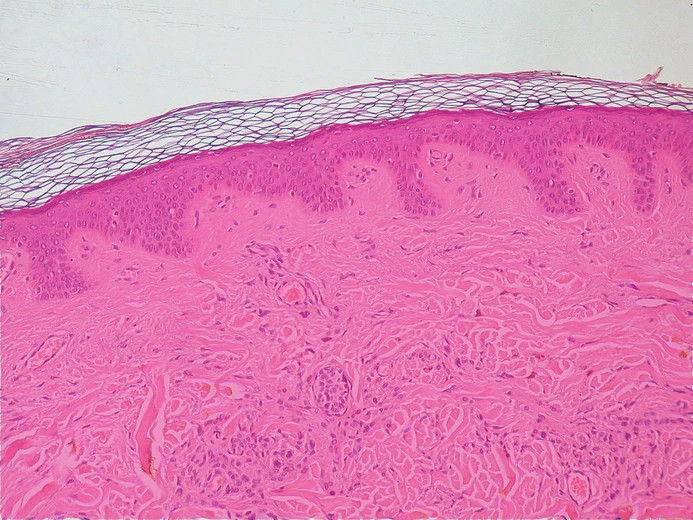

[Download uint32 labels and time indices](downloads/public-skin-dermis-labels.npz)

**Selection review:** Visually reviewed large histological layers; not a cell-level annotation.

**Sources:**

- https://scikit-image.org/docs/stable/api/skimage.data.html#skimage.data.skin

**Attribution/license:**  · See scikit-image dataset-specific attribution

## public-retina

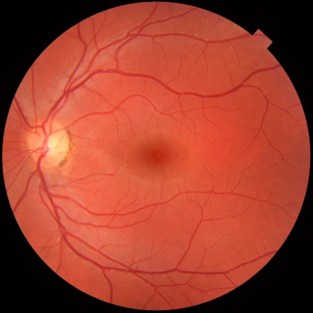

**Shape:** `(1, 3, 1, 1411, 1411)` (TCZYX) · **type:** Neurites & vessels · **storage:** 3.23 MB

### `optic_disc` — complete

Prompt: **the bright optic disc** · channels `1,2,3`

Timepoint 0: 1 predicted objects. 1/1 timepoints completed. Mask coverage: 1.3%.

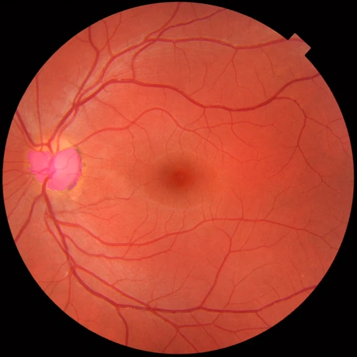

[Download uint32 labels and time indices](downloads/public-retina-optic_disc-labels.npz)

**Selection review:** Optic disc only. The previous vessel prompt selected the retinal field and was rejected from the curated gallery.

**Sources:**

- https://scikit-image.org/docs/stable/api/skimage.data.html#skimage.data.retina

**Attribution/license:**  · See scikit-image dataset-specific attribution

## public-diatoms

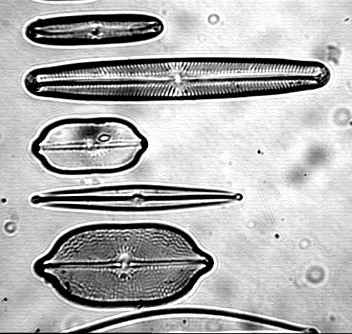

**Shape:** `(1, 3, 1, 486, 512)` (TCZYX) · **type:** Other structures · **storage:** 0.79 MB

### `diatoms` — complete

Prompt: **the individual diatoms** · channels `1,2,3`

Timepoint 0: 5 predicted objects. 1/1 timepoints completed. Mask coverage: 31.9%.

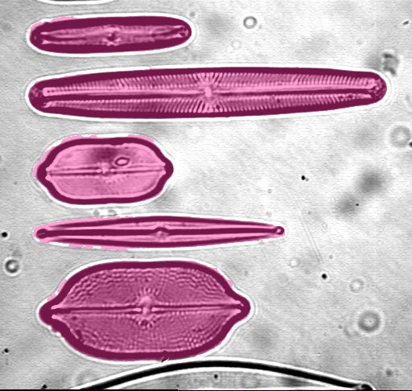

[Download uint32 labels and time indices](downloads/public-diatoms-diatoms-labels.npz)

### `round` — complete

Prompt: **round diatoms** · channels `1,2,3`

Timepoint 0: 2 predicted objects. 1/1 timepoints completed. Mask coverage: 14.8%.

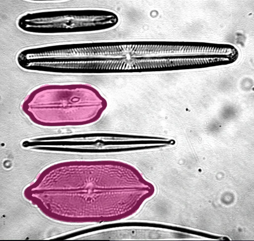

[Download uint32 labels and time indices](downloads/public-diatoms-round-labels.npz)

### `elongated` — complete

Prompt: **elongated diatoms** · channels `1,2,3`

Timepoint 0: 3 predicted objects. 1/1 timepoints completed. Mask coverage: 16.9%.

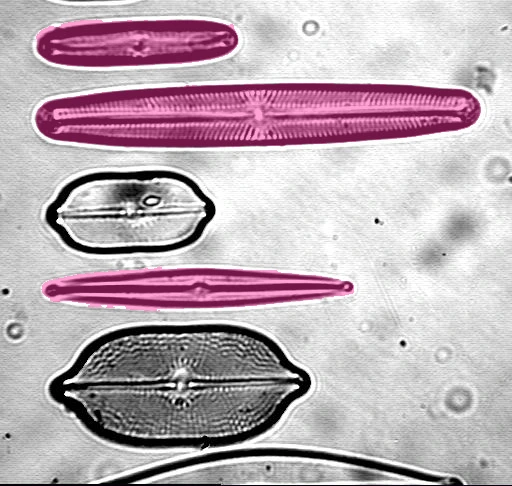

[Download uint32 labels and time indices](downloads/public-diatoms-elongated-labels.npz)

**Selection review:** Distinct visible diatom shapes; overlapping label classes are intentional.

**Sources:**

- https://imagej.net/ij/images/Diatoms.jpg

**Attribution/license:**  · Publicly downloadable sample; no separate file-specific redistribution license identified

## public-embryos

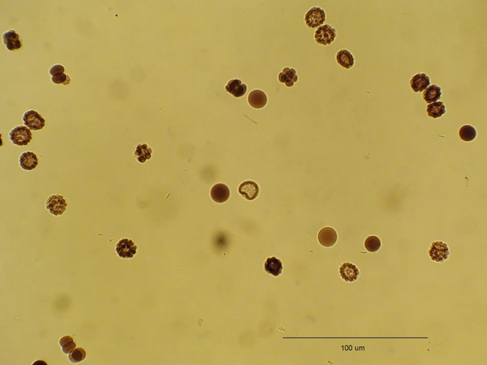

**Shape:** `(1, 3, 1, 1200, 1600)` (TCZYX) · **type:** Other structures · **storage:** 3.49 MB

### `embryos` — complete

Prompt: **the complete embryos** · channels `1,2,3`

Timepoint 0: 22 predicted objects. 1/1 timepoints completed. Mask coverage: 3.7%.

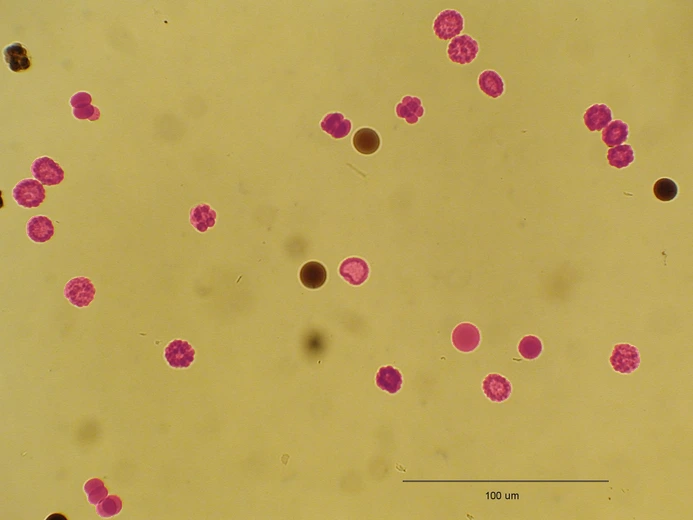

[Download uint32 labels and time indices](downloads/public-embryos-embryos-labels.npz)

**Selection review:** Complete visible embryo objects; the less convincing yolk label is omitted.

**Sources:**

- https://imagej.net/ij/images/embryos.jpg

**Attribution/license:**  · Publicly downloadable sample; no separate file-specific redistribution license identified

## local-CMU1-whole-section

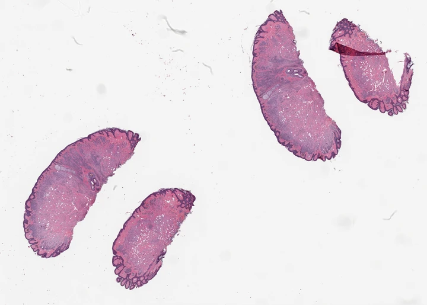

**Shape:** `(1, 3, 1, 2057, 2875)` (TCZYX) · **type:** Histology & tissue · **storage:** 5.36 MB

### `tissue` — complete

Prompt: **the entire tissue section, excluding the white background** · channels `1,2,3`

Timepoint 0: 1 predicted objects. 1/1 timepoints completed. Mask coverage: 18.8%.

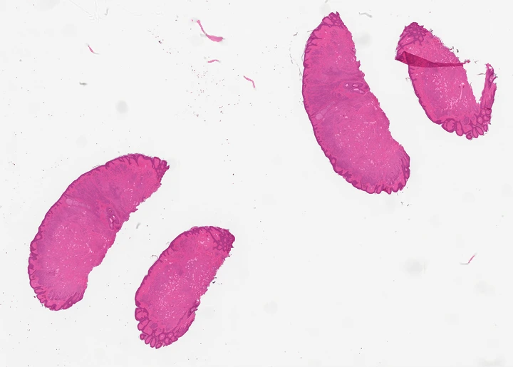

[Download uint32 labels and time indices](downloads/local-CMU1-whole-section-tissue-labels.npz)

**Selection review:** Overview of the entire acquired tissue scan; not a claim of DAB or cell-level segmentation.

**Sources:**

- https://openslide.cs.cmu.edu/download/openslide-testdata/Aperio/

**Attribution/license:**  · CC0; OpenSlide test data

## public-ki67-lymphoma-section

**Shape:** `(1, 3, 1, 2176, 1800)` (TCZYX) · **type:** Histology & tissue · **storage:** 7.46 MB

### `tissue` — complete

Prompt: **the entire tissue section, excluding the white background** · channels `1,2,3`

Timepoint 0: 1 predicted objects. 1/1 timepoints completed. Mask coverage: 49.7%.

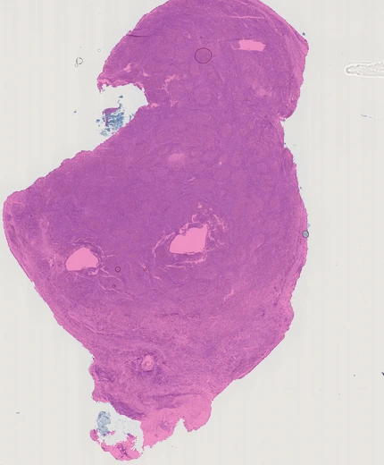

[Download uint32 labels and time indices](downloads/public-ki67-lymphoma-section-tissue-labels.npz)

**Selection review:** Section outline only. DAB-positive nuclei are demonstrated separately at native resolution.

**Sources:**

- https://zenodo.org/records/18302140

**Attribution/license:**  · CC BY 4.0; Thierry Pecot QuPath workshop

## local-mouse-brain-astrocytes-vessels

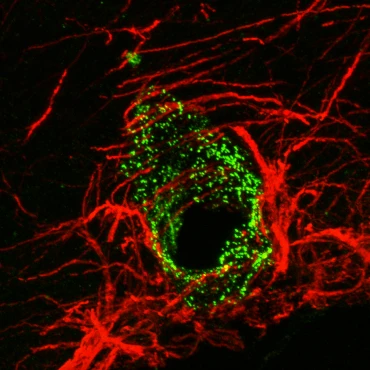

**Shape:** `(1, 3, 36, 370, 370)` (TCZYX) · **type:** Neurites & vessels · **storage:** 5.82 MB

### `vessel_profile` — complete

Prompt: **the bright green vessel cross section** · channels `1,2,3`

Timepoint 0: 1 predicted objects. 1/1 timepoints completed. Mask coverage: 12.8%.

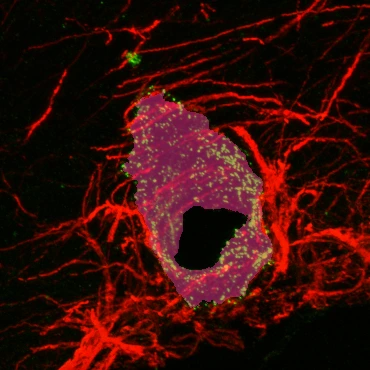

[Download uint32 labels and time indices](downloads/local-mouse-brain-astrocytes-vessels-vessel_profile-labels.npz)

**Selection review:** A local green vessel profile replaces the previous near-whole-field prediction.

**Sources:**

- https://imagej.net/ij/images/GFAP-FVII.zip
- https://imagej.net/ij/images/GFAP-FVII.txt

**Attribution/license:** Tony Collins / ImageJ for Microscopy · Public ImageJ sample; no separate data license declared.

Source is an RGB display stack, not separate quantitative fluorescence channels.

## public-lily-stem

**Shape:** `(1, 4, 1, 922, 922)` (TCZYX) · **type:** Other structures · **storage:** 5.68 MB

### `vascular_bundles` — complete

Prompt: **the bright green bundles, excluding the outer ring** · channels `1,2,3`

Timepoint 0: 7 predicted objects. 1/1 timepoints completed. Mask coverage: 10.1%.

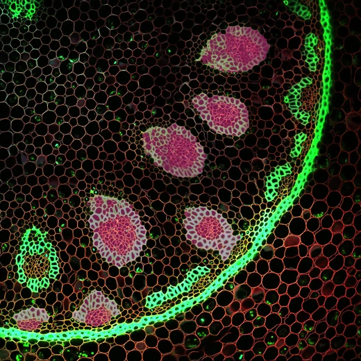

[Download uint32 labels and time indices](downloads/public-lily-stem-vascular_bundles-labels.npz)

**Selection review:** Visible green bundles are selected while the outer stem ring is excluded.

**Sources:**

- https://scikit-image.org/docs/stable/api/skimage.data.html#skimage.data.lily

**Attribution/license:**  · CC0; Genevieve Buckley, Monash Micro Imaging

## public-neurofilament-network-roi

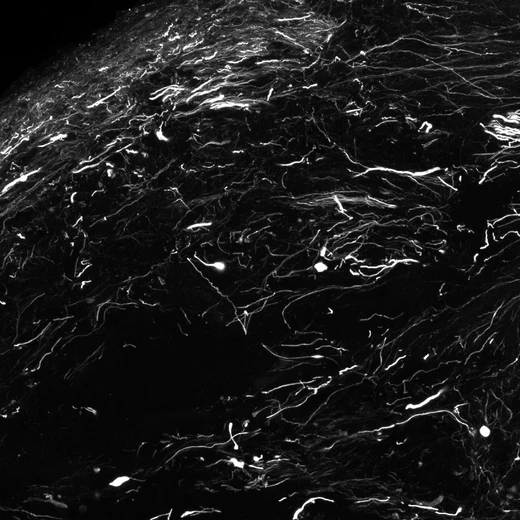

**Shape:** `(1, 1, 1, 1024, 1024)` (TCZYX) · **type:** Neurites & vessels · **storage:** 1.72 MB

### `fiber_network` — complete

Prompt: **the white filament network** · channels `1`

Timepoint 0: 1 predicted objects. 1/1 timepoints completed. Mask coverage: 23.9%.

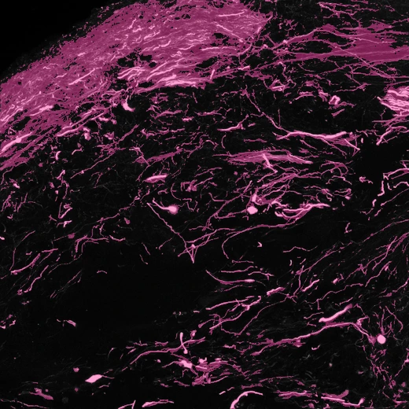

[Download uint32 labels and time indices](downloads/public-neurofilament-network-roi-fiber_network-labels.npz)

**Selection review:** Network-level foreground in a recorded Max-projection ROI; not individual axon tracing.

**Sources:**

- https://zenodo.org/records/13899833

**Attribution/license:** Yuanzheng Ma, Tsinghua University / Tsinghua-Berkeley Shenzhen Institute · CC-BY-4.0

## public-ki67-brown-nuclei-detail

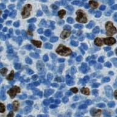

**Shape:** `(1, 3, 1, 192, 192)` (TCZYX) · **type:** Histology & tissue · **storage:** 0.11 MB

### `dab_positive` — complete

Prompt: **dark brown stained nuclei** · channels `1,2,3`

Timepoint 0: 18 predicted objects. 1/1 timepoints completed. Mask coverage: 11.2%.

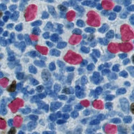

[Download uint32 labels and time indices](downloads/public-ki67-brown-nuclei-detail-dab_positive-labels.npz)

**Selection review:** A recorded native 192-pixel ROI distinguishes brown positive nuclei from blue negative tissue.

**Sources:**

- https://zenodo.org/records/18302140

**Attribution/license:**  · CC BY 4.0; Thierry Pecot QuPath workshop

## public-em-mitolab-folded-mitochondria

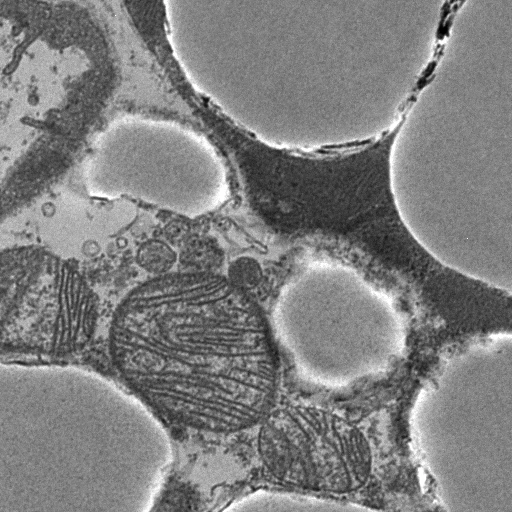

**Shape:** `(1, 1, 1, 512, 512)` (TCZYX) · **type:** EM · **storage:** 0.30 MB

### `mitochondria` — complete

Prompt: **the oval organelles with internal folds** · channels `1`

Timepoint 0: 3 predicted objects. 1/1 timepoints completed. Mask coverage: 14.9%. Foreground Dice: 0.965 against consensus (not an instance score).

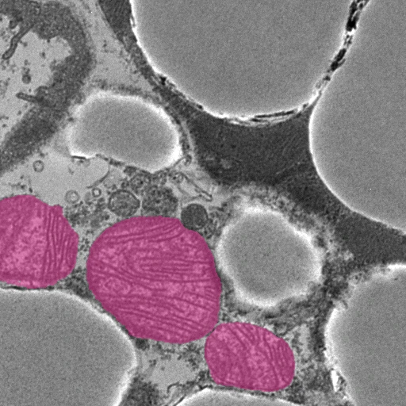

[Download uint32 labels and time indices](downloads/public-em-mitolab-folded-mitochondria-mitochondria-labels.npz)

**Selection review:** A native 2D EMPIAR patch with paired manual mitochondrial instance labels; selected after exploratory comparisons.

**Sources:**

- https://www.ebi.ac.uk/empiar/EMPIAR-11037/
- https://doi.org/10.1016/j.cels.2022.12.006

**Attribution/license:**  · EMPIAR-11037/CEM-MitoLab; original attribution retained

[Independent dataset reference, cyan](gallery/public-em-mitolab-folded-mitochondria-reference.webp) · [Reference label file](downloads/public-em-mitolab-folded-mitochondria-reference.npz)

## public-em-mitolab-mitochondrial-cluster

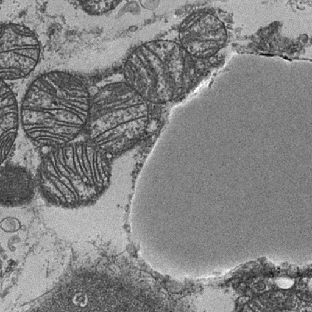

**Shape:** `(1, 1, 1, 512, 512)` (TCZYX) · **type:** EM · **storage:** 0.29 MB

### `mitochondria` — complete

Prompt: **mitochondria** · channels `1`

Timepoint 0: 7 predicted objects. 1/1 timepoints completed. Mask coverage: 21.0%. Foreground Dice: 0.936 against consensus (not an instance score).

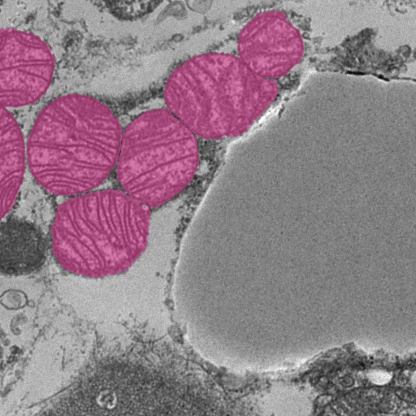

[Download uint32 labels and time indices](downloads/public-em-mitolab-mitochondrial-cluster-mitochondria-labels.npz)

**Selection review:** A second native 2D EMPIAR patch from the same acquisition; not an independent generalization benchmark.

**Sources:**

- https://www.ebi.ac.uk/empiar/EMPIAR-11037/
- https://doi.org/10.1016/j.cels.2022.12.006

**Attribution/license:**  · EMPIAR-11037/CEM-MitoLab; original attribution retained

[Independent dataset reference, cyan](gallery/public-em-mitolab-mitochondrial-cluster-reference.webp) · [Reference label file](downloads/public-em-mitolab-mitochondrial-cluster-reference.npz)

## public-phase-paramecium-vacuoles

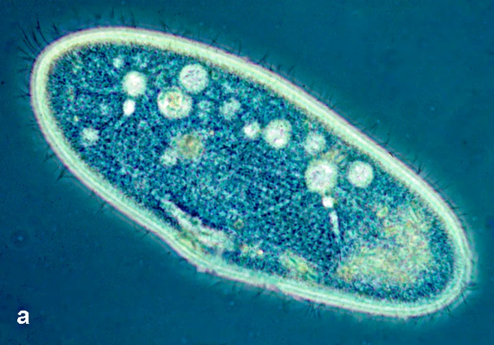

**Shape:** `(1, 3, 1, 521, 744)` (TCZYX) · **type:** Cells & organoids · **storage:** 1.06 MB

### `organism` — complete

Prompt: **the complete oval paramecium** · channels `1,2,3`

Timepoint 0: 1 predicted objects. 1/1 timepoints completed. Mask coverage: 45.7%.

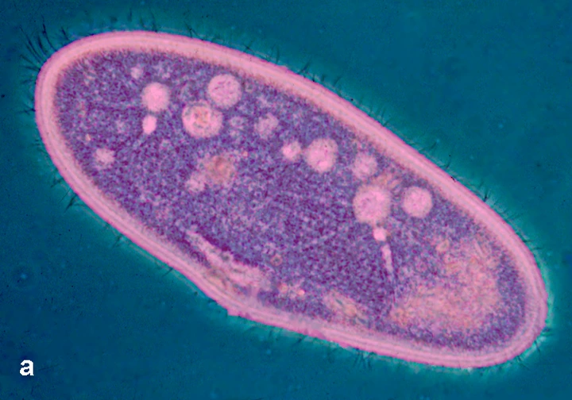

[Download uint32 labels and time indices](downloads/public-phase-paramecium-vacuoles-organism-labels.npz)

### `round_vacuoles` — complete

Prompt: **the bright circular vacuoles inside the organism** · channels `1,2,3`

Timepoint 0: 6 predicted objects. 1/1 timepoints completed. Mask coverage: 2.4%.

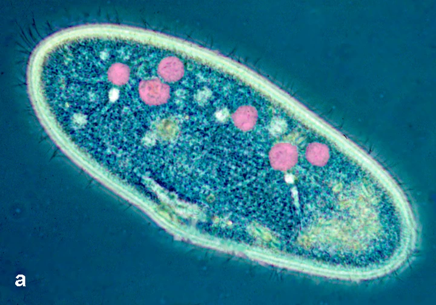

[Download uint32 labels and time indices](downloads/public-phase-paramecium-vacuoles-round_vacuoles-labels.npz)

**Selection review:** Visible organism body and six bright circular interior structures. The two-contractile-vacuoles query selected the wrong structures and is excluded; circular masks are not validated contractile-vacuole identities.

**Sources:**

- https://www6.pbrc.hawaii.edu/allen/ch01/00-pm.html

**Attribution/license:** Klaus Hausmann; Richard D. Allen Image Collection, Pacific Biosciences Research Center, University of Hawaii · Educational/research use encouraged; commercial reproduction may require permission. See the Richard Allen collection foreword.

## public-phase-paramecium-food

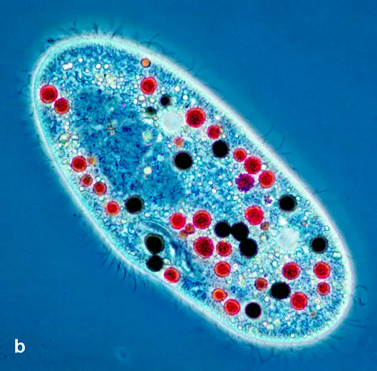

**Shape:** `(1, 3, 1, 731, 744)` (TCZYX) · **type:** Cells & organoids · **storage:** 1.36 MB

### `organism` — complete

Prompt: **the complete oval paramecium** · channels `1,2,3`

Timepoint 0: 1 predicted objects. 1/1 timepoints completed. Mask coverage: 42.5%.

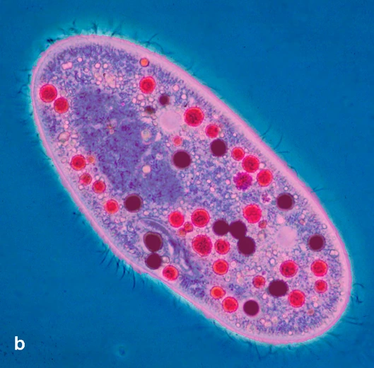

[Download uint32 labels and time indices](downloads/public-phase-paramecium-food-organism-labels.npz)

### `red_food_vacuoles` — complete

Prompt: **the red circular food vacuoles** · channels `1,2,3`

Timepoint 0: 28 predicted objects. 1/1 timepoints completed. Mask coverage: 4.2%.

[Download uint32 labels and time indices](downloads/public-phase-paramecium-food-red_food_vacuoles-labels.npz)

**Selection review:** Organism body and red carmine-containing food vacuoles. The black-vacuole query selected red structures and is excluded. No completeness claim for every small vacuole.

**Sources:**

- https://www6.pbrc.hawaii.edu/allen/ch01/00-pm.html

**Attribution/license:** Klaus Hausmann; Richard D. Allen Image Collection, Pacific Biosciences Research Center, University of Hawaii · Educational/research use encouraged; commercial reproduction may require permission. See the Richard Allen collection foreword.

## public-em-chloroplast

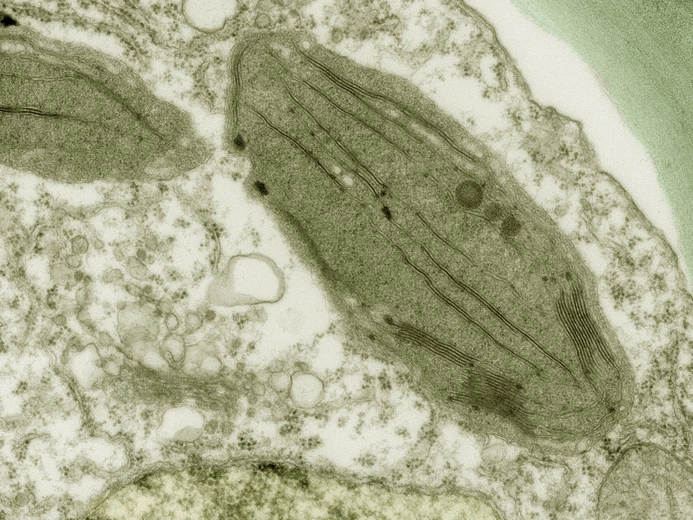

**Shape:** `(1, 3, 1, 1800, 2400)` (TCZYX) · **type:** EM · **storage:** 14.98 MB

### `chloroplast` — complete

Prompt: **the large oval chloroplast in the center** · channels `1,2,3`

Timepoint 0: 1 predicted objects. 1/1 timepoints completed. Mask coverage: 24.1%.

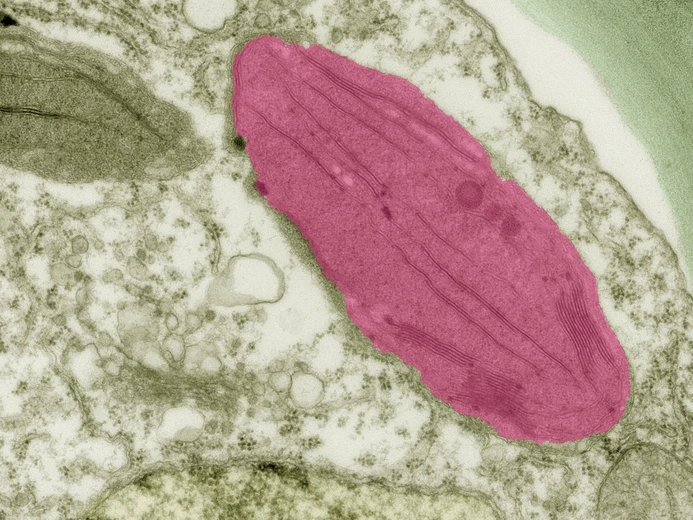

[Download uint32 labels and time indices](downloads/public-em-chloroplast-chloroplast-labels.npz)

### `dark_granules` — complete

Prompt: **the dark round granules inside the central chloroplast** · channels `1,2,3`

Timepoint 0: 3 predicted objects. 1/1 timepoints completed. Mask coverage: 0.3%.

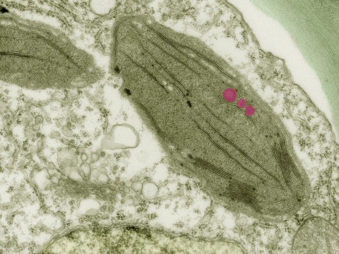

[Download uint32 labels and time indices](downloads/public-em-chloroplast-dark_granules-labels.npz)

**Selection review:** Central chloroplast outline and three visible dark round granules. The membrane-stack query returned no masks; the generic all-chloroplasts query selected granules instead. Neither is shown. Source-described false-colour TEM, without projection.

**Sources:**

- https://wellcomecollection.org/works/bx3dctp2

**Attribution/license:** Kevin Mackenzie, University of Aberdeen; Wellcome Collection · CC BY 4.0

## public-fluorescence-endothelial

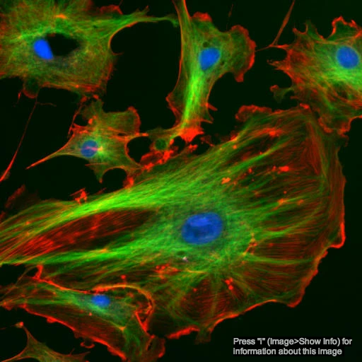

**Shape:** `(1, 3, 1, 512, 512)` (TCZYX) · **type:** Cells & organoids · **storage:** 0.57 MB

### `cell_body` — complete

Prompt: **the large elongated cell in the lower half** · channels `1,2,3`

Timepoint 0: 1 predicted objects. 1/1 timepoints completed. Mask coverage: 40.8%.

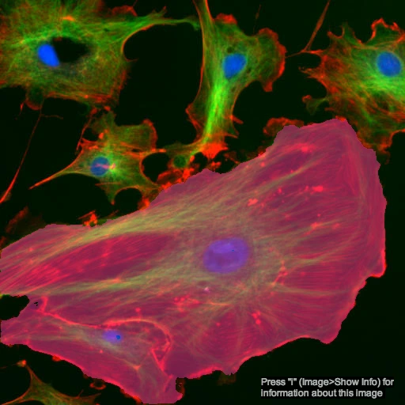

[Download uint32 labels and time indices](downloads/public-fluorescence-endothelial-cell_body-labels.npz)

### `nucleus` — complete

Prompt: **the blue nucleus inside the large cell in the lower half** · channels `1,2,3`

Timepoint 0: 1 predicted objects. 1/1 timepoints completed. Mask coverage: 0.8%.

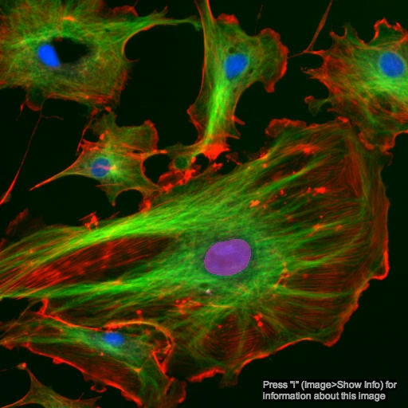

[Download uint32 labels and time indices](downloads/public-fluorescence-endothelial-nucleus-labels.npz)

**Selection review:** Visible body of the large lower cell and its blue nucleus in the same view. The cell extends beyond the acquired left edge; the mask covers its visible portion. Fine red actin-network prompting was unsuccessful.

**Sources:**

- https://imagej.net/ij/images/FluorescentCells.txt

**Attribution/license:** Molecular Probes demonstration slide; ImageJ public samples · Public ImageJ sample; no separate file-specific redistribution license identified

## public-fluorescence-kidney

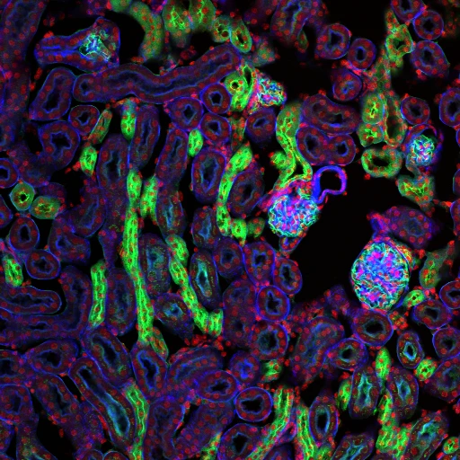

**Shape:** `(1, 3, 1, 512, 512)` (TCZYX) · **type:** Cells & organoids · **storage:** 1.35 MB

### `glomeruli` — complete

Prompt: **the bright round glomeruli** · channels `1,2,3`

Timepoint 0: 2 predicted objects. 1/1 timepoints completed. Mask coverage: 2.5%.

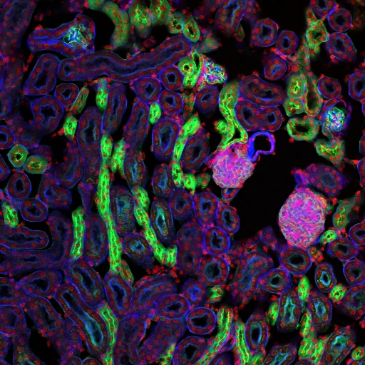

[Download uint32 labels and time indices](downloads/public-fluorescence-kidney-glomeruli-labels.npz)

**Selection review:** Two conspicuous right-side glomerular profiles in native optical section 8. Other profiles are missed; this is a selected qualitative demonstration, not complete glomerulus counting. Tubule/lumen queries and the smaller glomerulus ROI were not convincing.

**Sources:**

- https://scikit-image.org/docs/stable/api/skimage.data.html#skimage.data.kidney

**Attribution/license:** Genevieve Buckley, Monash Micro Imaging (2018); scikit-image data.kidney · CC0; scikit-image kidney dataset

## public-ihc-pancreatic-islet

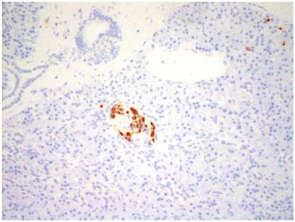

**Shape:** `(1, 3, 1, 458, 608)` (TCZYX) · **type:** Cells & organoids · **storage:** 0.78 MB

### `islet` — complete

Prompt: **the entire pancreatic islet in the center** · channels `1,2,3`

Timepoint 0: 1 predicted objects. 1/1 timepoints completed. Mask coverage: 1.8%.

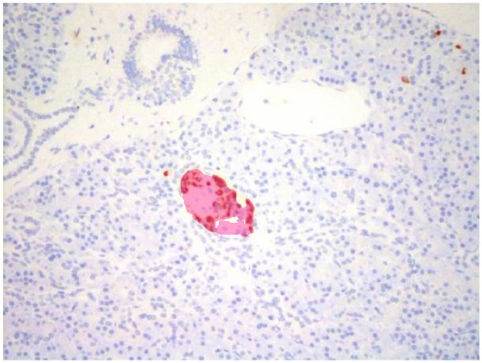

[Download uint32 labels and time indices](downloads/public-ihc-pancreatic-islet-islet-labels.npz)

**Selection review:** Whole central insulin-stained islet profile. Brown-cell prompting on this overview filled the entire islet instead of separating positive cells; that query is excluded. Publication JPEG, qualitative only.

**Sources:**

- https://doi.org/10.1177/1177390117690140

**Attribution/license:** Joseph de Nanassy and Dina El Demellawy (2017); DOI 10.1177/1177390117690140 · CC BY-NC 4.0; article authors (2017). Non-commercial educational/research demonstration.

## public-ihc-hyperplastic-islet

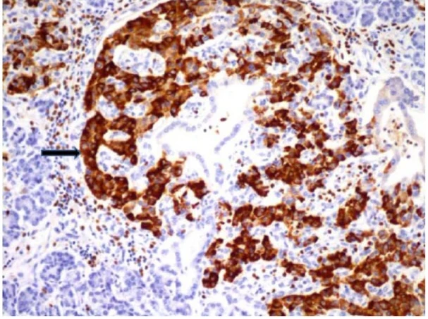

**Shape:** `(1, 3, 1, 453, 607)` (TCZYX) · **type:** Cells & organoids · **storage:** 1.00 MB

### `brown_tissue` — complete

Prompt: **the brown insulin-positive tissue** · channels `1,2,3`

Timepoint 0: 1 predicted objects. 1/1 timepoints completed. Mask coverage: 28.0%.

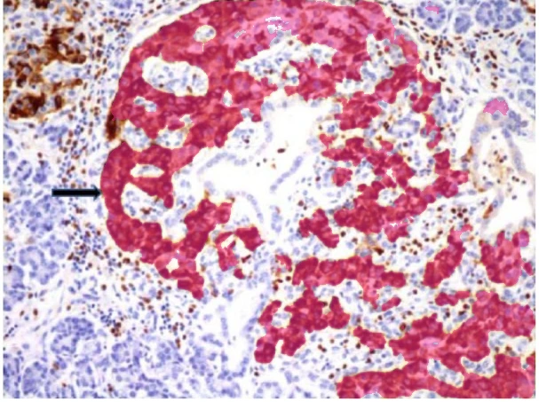

[Download uint32 labels and time indices](downloads/public-ihc-hyperplastic-islet-brown_tissue-labels.npz)

**Selection review:** Selected brown insulin-positive tissue regions within the published enlarged islet panel. Not individual positive-cell counts or validated stain quantification. The original arrow remains visible; whole-islet and lumen queries are excluded.

**Sources:**

- https://doi.org/10.1177/1177390117690140

**Attribution/license:** Joseph de Nanassy and Dina El Demellawy (2017); DOI 10.1177/1177390117690140 · CC BY-NC 4.0; article authors (2017). Non-commercial educational/research demonstration.
